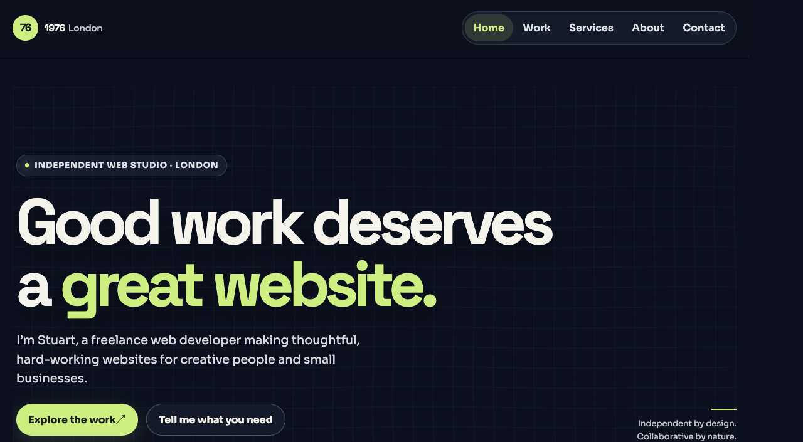

# 1976 London

Independent London web development studio, built as a fast, responsive Astro site.

<p align="center">
  <a href="https://1976.london"><strong>Visit the live site</strong></a>
  &nbsp;·&nbsp;
  <a href="https://github.com/stuartlondon/1976london-astro">View the source</a>
</p>

<p align="center">
  <a href="https://1976.london">
    
  </a>
</p>

## What’s here

- **Home** — a clear introduction, studio approach, featured projects, and contact calls to action
- **Work** — a portfolio overview and individual case studies
- **Services** — Astro, WordPress, portfolio, small-business, and maintenance services
- **About** — background and a straightforward project process
- **Contact** — project enquiry form, direct contact details, and an on-site sent confirmation

The visual system pairs deep navy with a bright lime accent. Motion is kept subtle, the hero mesh responds to fine-pointer movement, and reduced-motion preferences are respected.

## Built with

- Astro 7, generating static HTML
- TypeScript for page and project data
- CSS with responsive layouts and reduced-motion support
- FormSubmit for enquiry delivery

## Run locally

Requirements: Node.js `>=22.12.0`.

```sh
npm ci
npm run dev
```

Create and preview a production build:

```sh
npm run build
npm run preview
```

The finished static site is written to `dist/`.

## Deploy

For cPanel hosting, zip the **contents** of `dist/`, not the `dist` folder itself:

```sh
(cd dist && zip -r -FS ../1976-london-site.zip .)
```

Upload `1976-london-site.zip` to `public_html` and extract it there. The archive contains the generated `robots.txt` and sitemap as well as the site pages and assets; check those files are the versions you intend to publish before replacing existing copies.

## Contact form

Enquiries are sent through FormSubmit to `stuart@1976.london`. FormSubmit requires an initial activation confirmation. After a successful submission, it redirects back to `/contact/?sent=1` and the site displays an inline confirmation.

## Updating portfolio content

Project details, case-study content, links, and images are maintained in [`src/data/projects.ts`](./src/data/projects.ts). Place project images in `public/` and reference them from that data file.

## Repository structure

```text
public/                 Project images and site icons
screenshots/            README preview image
src/components/         Shared Astro components
src/data/projects.ts    Portfolio and case-study content
src/layouts/            Shared page layout
src/pages/              Home, About, Services, Contact, and Work routes
src/styles/global.css   Site-wide design and responsive styles
```
